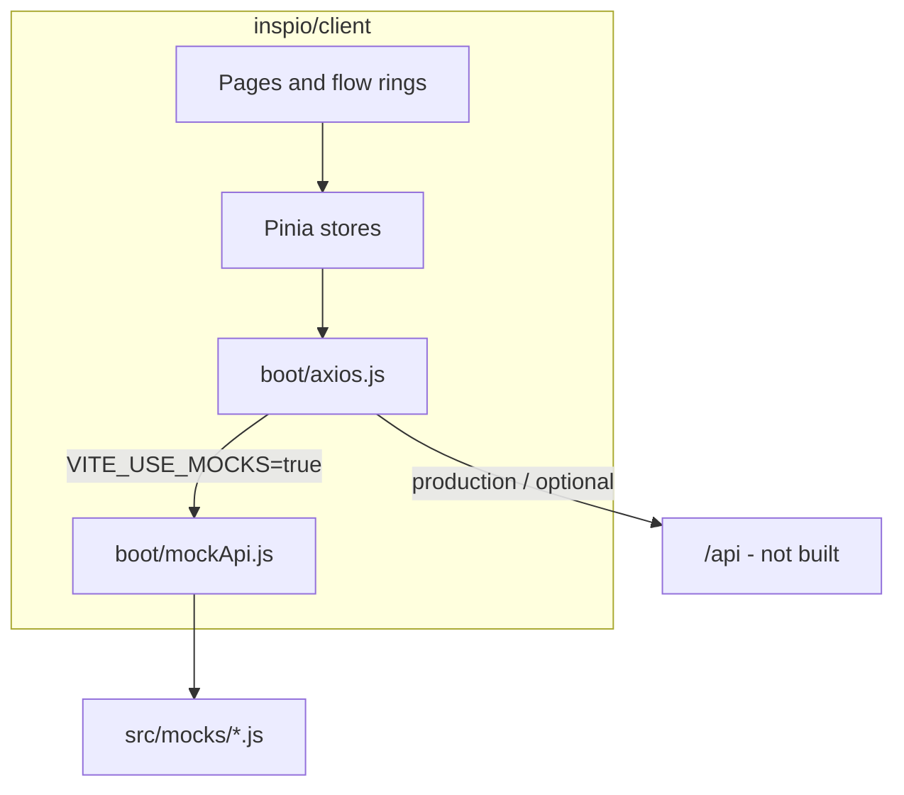

# PEQI Client Prototype Plan

## Context

- **inspio repo today:** empty shell — [`.gitignore`](.gitignore) + [`Logo Fa.png`](Logo%20Fa.png) only.
- **Reference scaffold:** [`/home/ali/code/cario/client`](/home/ali/code/cario/client) — Quasar 2 + Vue 3 + Pinia + Vue Router + vue-i18n (fa-IR default, RTL).
- **Domain requirements:** 14-step **تأیید نوع** (type-approval) workflow from the PEQI inspection PDF (`گردش کار بازرسی.pdf`):

| Step | Persian title | Route / ring |
|------|---------------|--------------|
| 1 | ثبت و ارجاع نامه درخواست تأیید نوع | `typeapproval` ring 1 |
| 2 | فرم درخواست تأیید نوع | ring 2 |
| 3 | صدور پیش‌فاکتور | ring 3 |
| 4 | تحویل مدارک | ring 4 |
| 5 | تأیید پیش‌فاکتور و آغاز فرآیند | ring 5 |
| 6 | بررسی مدارک | ring 6 |
| 7 | بازرسی فیزیکی محصول | ring 7 |
| 8 | بازرسی خط تولید + ارزیابی اولیه QMS | ring 8 |
| 9 | گزارش‌های فنی + گزارش فنی کل | ring 9 |
| 10 | گزارش استانداردها (۸۵گانه) | ring 10 |
| 11 | تکمیل موارد + تأیید مدیر فنی | ring 11 |
| 12 | وضعیت مالی + فاکتور + صورتحساب | ring 12 |
| 13 | تکمیل سامانه اداره استاندارد + تأیید نهایی | ring 13 |
| 14 | صدور گزارش تأیید نوع | ring 14 |

**Your choices:** high-fidelity forms per step; include mocked **admin** (users/roles/backups); exclude chat/reports.

---

## Architecture



**Key pattern from cario:** workflow rings are loaded dynamically in [`flow-job.vue`](/home/ali/code/cario/client/src/components/flow-job.vue):

```js
import(`src/pages/flow/${flow_name}/ring-${ring_order}.vue`)
```

We keep this engine (`flow-host`, `flow-ring`, `flow-steps`, cartable) and swap cario domain flows for one PEQI flow: `typeapproval`.

---

## Phase 1 — Scaffold and rebrand

1. **Copy cario client** into [`client/`](client/) (full tree: components, layouts, stores, boot, i18n, css, public).
2. **Remove cario-specific domain pages** under `client/src/pages/flow/` (`testreq`, `seatstatic`, `seatdynamic`, `seatbelt*`, `latch`, `testdefinition-start.vue`) and cario form i18n under `client/src/i18n/forms/`.
3. **Remove chat** pages/routes/stores/boot references (`/chat`, `/contacts`, `chatStore`, WebSocket in `MainLayout`) — not in scope.
4. **Rebrand:**
   - Move logo → [`client/src/assets/logo-peqi.png`](client/src/assets/logo-peqi.png) (from root `Logo Fa.png`; remove duplicate from repo root after copy).
   - Update [`client/package.json`](client/package.json) `productName` → `peqi`.
   - Update [`client/src/i18n/fa-IR/index.js`](client/src/i18n/fa-IR/index.js) + `en-US`:
     - `appDescription`: «سامانه پایش کیفیت آزما پارت — تأیید نوع»
     - `appOwner`: PEQI / پایش کیفیت آزما پارت
   - Update [`client/src/pages/IndexPage.vue`](client/src/pages/IndexPage.vue) to always show PEQI logo (not dev-only SYSio text).
   - Tune [`client/src/css/quasar.variables.scss`](client/src/css/quasar.variables.scss) toward logo blue/orange accents (primary blue, accent orange).
5. **Adjust routes** in [`client/src/router/routes.js`](client/src/router/routes.js):

| Route | Page |
|-------|------|
| `/` | Home |
| `/login` | Login |
| `/cartable` | Workflow inbox |
| `/flow/typeapproval` | Entry to ring 1 (demo / direct access) |
| `/admin/users` | Users (mocked) |
| `/admin/roles` | Roles (mocked) |
| `/admin/backups` | Backups (mocked) |
| `/user/pass` | Change password |
| `/changelog` | Changelog |

---

## Phase 2 — Mock API (no backend)

Add a **single interception layer** so all existing stores/components work unchanged.

**New files:**
- [`client/src/mocks/index.js`](client/src/mocks/index.js) — route matcher + in-memory state
- [`client/src/mocks/auth.js`](client/src/mocks/auth.js) — login, refresh, menu, JWT-like fake token
- [`client/src/mocks/crtbl.js`](client/src/mocks/crtbl.js) — cartable list, load task, flowinit, save/forward/backward
- [`client/src/mocks/admin.js`](client/src/mocks/admin.js) — users, roles, backups CRUD
- [`client/src/mocks/lookups.js`](client/src/mocks/lookups.js) — customers, inspectors, standards, document types
- [`client/src/mocks/fixtures/typeapproval.js`](client/src/mocks/fixtures/typeapproval.js) — seed tasks at various rings + sample form data

**Wire-up in [`client/src/boot/axios.js`](client/src/boot/axios.js):**
- When `import.meta.env.VITE_USE_MOCKS !== 'false'` (default **on** for this prototype), short-circuit requests in a request interceptor and return `{ data, status: 200 }`.
- Disable refresh-cookie / WebSocket paths for mock mode.
- Generate a simple signed-looking JWT in mock login so existing `loginStore` / auth guard keep working.

**Demo users (mock):**
- `admin` / `demo` — full menu (cartable + admin)
- `inspector` / `demo` — cartable + workflow only
- `manager` / `demo` — cartable + approval steps

**Mock menu** (served from `/user/menu`): کارپوشه، مدیریت کاربران، نقش‌ها، پشتیبان‌گیری، تغییرات.

**Mock cartable:** 3–5 sample type-approval cases at rings 1, 4, 7, 10, 14 so the customer can click through the full lifecycle from the inbox.

---

## Phase 3 — 14-step `typeapproval` flow (high fidelity)

Create [`client/src/pages/flow/typeapproval/ring-1.vue`](client/src/pages/flow/typeapproval/ring-1.vue) … `ring-14.vue`, each wrapping `<flow-ring flow="typeapproval" :ring="N">`.

Reuse cario building blocks: `zen-file-upload`, `zen-date`, `zen-lookup`, `zen-table`, `zen-dialog`, `Qa*` where applicable.

**Per-ring form design** (inferred from workflow PDF; no detailed form spec exists in repo — we design from step names + standard type-approval practice):

| Ring | Form sections (high fidelity) |
|------|-------------------------------|
| **1** | Letter metadata (date, number, applicant), product/vehicle info, referral target (lookup), attached scan |
| **2** | Full application: manufacturer, model, VIN range, component list, contact persons, declaration checkboxes |
| **3** | Proforma invoice: line items table, unit prices, VAT, totals, payment terms, PDF preview slot |
| **4** | Document delivery checklist: ISO 6924, E-mark, COP PLAN, BOM, commitment letters — each with upload + received date + status |
| **5** | Proforma confirmation: approval signature, process start date, assigned inspector team |
| **6** | Document review matrix: per-document reviewer, pass/fail/comment, resubmission flag |
| **7** | Physical inspection: structured checklist (exterior, interior, safety items), photo gallery (multi-upload), inspector notes |
| **8** | Production line visit: facility info, QMS initial evaluation form (sections A–F style scoring table) |
| **9** | Technical reports list + overall summary report fields, conclusions, non-conformities table |
| **10** | 85-row standards compliance table (standard no., title, result, evidence ref) with filter/search |
| **11** | Open items tracker, technical manager sign-off, approval date |
| **12** | Financial status, final invoice, billing statement, payment confirmation |
| **13** | National standards system (NACI) registration fields, final approval checkbox, certificate number |
| **14** | Type-approval report issuance: report number, validity dates, print/preview mock, archive upload |

**i18n:** add [`client/src/i18n/forms/typeapproval.js`](client/src/i18n/forms/typeapproval.js) (fa + en labels) and wire via `useFormI18n('typeapproval.N')` like cario.

**Mock `flowinit`:** return 14 rings with bilingual titles matching the table above; `policy` flags control forward/backward/finish per ring.

---

## Phase 4 — Admin pages (mocked)

Keep existing cario admin pages ([`UsersPage.vue`](/home/ali/code/cario/client/src/pages/admin/UsersPage.vue), `RolesPage`, `BackupsPage`) — they already call `/admin/*` endpoints. Wire those URLs in `mocks/admin.js` with realistic Persian sample data (5 users, 3 roles, 2 backup entries).

No functional backup restore — show UI states only (list, create dialog, success toast).

---

## Phase 5 — Polish for customer demo

- Pre-seed cartable so opening a task at ring 7 shows partially filled inspection data.
- Forward/save in mock updates in-memory state and advances ring (so workflow feels live).
- `npm run dev` on port 9000; document in [`client/README.md`](client/README.md): demo credentials, mock mode flag.
- Optional: extract blue/orange from logo for header accent bar.

---

## Important constraint

The PDF only lists **step names**, not field-level form layouts. For true pixel-perfect fidelity you would need real form templates (Word/PDF samples). **Assumption:** we build professionally realistic forms from step descriptions; you can refine fields after the first demo. If you have actual blank forms (e.g. from NACI), share them and we align rings 2, 7, 8, 10 more closely.

---

## Files touched (summary)

| Action | Path |
|--------|------|
| Copy + adapt | `client/**` (from cario) |
| New | `client/src/mocks/**` |
| New | `client/src/pages/flow/typeapproval/ring-1..14.vue` |
| New | `client/src/i18n/forms/typeapproval.js` |
| Edit | `client/src/router/routes.js`, `boot/axios.js`, i18n, branding assets |
| Delete | cario flow folders, chat module, root `Logo Fa.png` (after move) |

**Not in scope:** `api/` backend, WebSocket, chat, real PDF generation, database.
